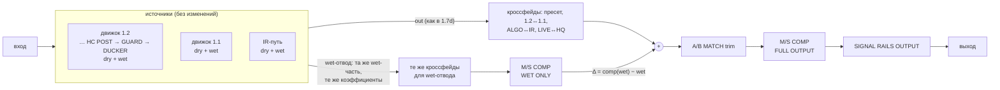
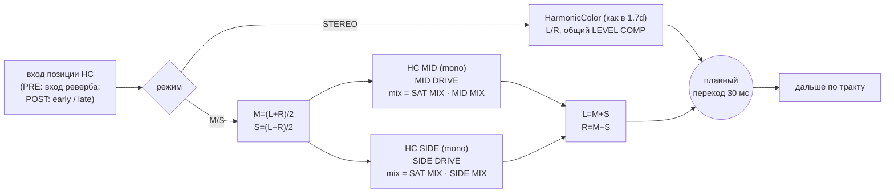

# MASTER SPACE 1.8 STUDIO — архитектура M/S OUTPUT COMPRESSOR и M/S HARMONIC COLOR

Статус: **утверждено владельцем и реализовано** в `claude/1.8-studio` (PR #8): M/S HARMONIC COLOR `02e5398`, M/S OUTPUT COMPRESSOR `2506124`, интерфейс `3f4c25c`.
Основа: реальный код 1.7d (`MSEngine.h`, `PluginProcessor.cpp`, `HarmonicColor.h`), а не схема «по памяти».

## 0. Как устроен тракт сейчас (1.7d)

Dry/wet смешиваются в **трёх** местах, поверх них идут **четыре** кроссфейда:

| Где смешивается | Что внутри |
|---|---|
| движок 1.2 (`MSEngine::process`) | HC PRE → ревербератор → Dynamic Cut / REVERB EQ → **HC POST** (early, late) → RESONANCE GUARD → SMART DUCKER → `out = (dry·cos + wet·sin)·OUTPUT·level lock` |
| замороженный движок 1.1 (`legacy`) | своё смешивание, без HC/RG/Ducker |
| IR-путь (`processIRPath`) | свёртка → high cut → width → `out = (dry·cos + wet·sin)·OUTPUT` |

Кроссфейды (все линейные, на уже смешанном сигнале): смена состояния/пресета (две копии пути), 1.2 ↔ 1.1, ALGO ↔ IR, LIVE ↔ STUDIO HQ. Затем A/B MATCH trim, затем SIGNAL RAILS OUTPUT.

Вывод: компрессор **внутри** движка пришлось бы ставить в 3 места × 2 копии пути. При каждом кроссфейде работали бы два компрессора с разными огибающими: двойная обработка и скачки GR. Поэтому — **один экземпляр на уровне процессора**.

## 1. M/S OUTPUT COMPRESSOR (Issue #6)

- **Один экземпляр**, одна пара огибающих MID/SIDE: двойной обработки при кроссфейдах нет.
- **WET ONLY (по умолчанию).** Каждый источник дополнительно отдаёт свою wet-часть ровно с теми же коэффициентами, что в смешивании, и она проходит те же кроссфейды. Компрессор обрабатывает сумму wet и добавляет к выходу только разницу `Δ = comp(wet) − wet`.
  - INSERT: dry остаётся нетронутым, бит в бит.
  - AUX: dry = 0, сжимается весь (wet) выход.
  - ALGO и IR: один и тот же отвод, переходы ALGO ↔ IR мягкие.
  - Движок 1.1: тот же отвод.
- **FULL OUTPUT.** После dry/wet, OUTPUT и A/B MATCH, на всём выходе. Порядок «trim → компрессор» — как в ТЗ.
- **M/S:** `M = (L+R)/2`, `S = (L−R)/2`, `L = M+S`, `R = M−S`. Нормировка без потерь: при GR = 0 и makeup 0 dB выход равен входу.
- **Детектор:** feed-forward, RMS-огибающая около 10 мс. Отдельно для M и S, по сигналу после SIDECHAIN HPF (фильтр только в детекторе, в звуке его нет).
- **Кривая и сглаживание:** soft knee (0..12 dB); attack/release в логарифмической области по времени. Параметры сглажены, без щелчков.
- **PARALLEL MIX:** `wet_out = wet + mix·Δ`.
- **Мягкий bypass:** включение/выключение — плавная рампа 20 мс на Δ.
  - Когда COMP выключен и рампа закончилась, код компрессора не выполняется: **звук бит в бит как в 1.7d**.
  - Ratio 1:1, Mix 0 % или makeup 0 при отсутствии GR дают Δ = 0.
- **Задержка 0:** без lookahead; в STUDIO HQ отвод уже выровнен вместе с путём.
- **GR-телеметрия:** атомики M и S, как у SIGNAL RAILS.
- **Порог в dBFS выходного уровня** (после OUTPUT): то, что видно на индикаторе OUTPUT.
- **SMART DUCKER** стоит раньше в wet-цепи; компрессор его не заменяет и не дублирует.

Параметры (новые ID, по умолчанию модуль выключен):

| Параметр | Диапазон | MID по умолч. | SIDE по умолч. |
|---|---|---|---|
| THRESHOLD | −60..0 dBFS | −24 | −24 |
| RATIO | 1:1..10:1 | 2:1 | 2:1 |
| ATTACK | 0.1..100 ms | 20 | 30 |
| RELEASE | 30..3000 ms | 250 | 400 |
| KNEE | 0..12 dB | 6 | 6 |
| MAKEUP | −12..+12 dB | 0 | 0 |

Общие: `COMP ON` (выкл), `ROUTING` WET ONLY / FULL OUTPUT, `PARALLEL MIX` 0..100 % (100), `SC HPF` 20..500 Hz (120) + OFF.

## 2. M/S HARMONIC COLOR (Issue #7)

- **STEREO (по умолчанию)** — существующий класс без единого изменения в его пути. Старые пресеты и проекты звучат бит в бит.
- **M/S** — на каждой существующей позиции (PRE; POST early; POST late) два **независимых mono**-процессора MID и SIDE. У каждого свои drive, mix, огибающие LEVEL COMP и guard-фильтры, поэтому энергокомпенсация не перетекает между M и S.
- Общие для обоих: CHARACTER (SOFT/TUBE/TAPE), COLOR, LEVEL COMP, PRE/POST, LIVE/HQ (то же 4× oversampling — та же задержка, выравнивание не меняется).
- **SATURATION MIX на MAIN** — общий регулятор глубины: `mixMID = SAT MIX · MID MIX`, `mixSIDE = SAT MIX · SIDE MIX`. При 0 % сатурации нет нигде; лампы работают как раньше.
- Ширина не «плывёт»: из моно-сигнала S = 0, и SIDE-процессор получает тишину. Остаточный путь HC: `x + mix·h(x)`, `h(0) = 0`. Проверяется тестом: при mix 0 и нейтральном drive M/S = вход.
- Переключение STEREO ↔ M/S — 30 мс равногромкий переход, оба пути работают только на время перехода.
- CPU: класс получает одноканальный режим. Две mono-копии стоят примерно столько же, сколько одна стерео. Стерео-путь при этом не меняется; это проверяется эталонными рендерами с включённым HC.

Новые ID: `hcMode` (STEREO), `hcMidDrive`, `hcSideDrive` (стартуют от текущего DRIVE), `hcMidMix`, `hcSideMix` (100 %).

## 3. Порядок в wet-цепи 1.8

`HC PRE → реверб → Dynamic Cut / REVERB EQ → HC POST (STEREO или M/S) → RESONANCE GUARD → SMART DUCKER → dry/wet → [COMP WET ONLY] → A/B trim → [COMP FULL OUTPUT] → SIGNAL RAILS`

Насыщение раньше компрессии. Компрессор не меняет насыщение, насыщение не меняет компрессор.

## 4. Интерфейс 1.8

- **Шапка:** слева только слоган **DON’T ADD REVERB. CREATE SPACE.** (вариант A, одна строка — выбор владельца); эмблема, волна и MASTERASTAKHOVSOUND убраны. MASTER SPACE по центру без изменений.
- **Верхняя полоса:** `‹ ИМЯ ПРЕСЕТА ›` (290 px, без категории — она в подсказке и браузере), затем STUDIO ROOM / CHAMBER / HALL / ATMOS TAIL, справа MAIN / REVERB EQ и MIX / PRO.
- **Нижняя полоса MAIN:** ★ SAVE SAVE AS │ A B A→B UNDO MATCH │ INSERT AUX IR │ SMART DUCKER, RESONANCE GUARD, HARMONIC COLOR (+ SATURATION MIX), **M/S COMP**.
- **На других страницах** инструменты пресета стоят рядом с именем, как раньше. Кнопки не теряются; их действия, параметры и автоматизация не меняются.
- **PRO › COMP:** два симметричных блока MID (сине-бирюзовый) и SIDE (золотой), у каждого 6 ручек и GR-индикатор; общие ROUTING, PARALLEL MIX, SC HPF.
- **PRO › COLOR:** переключатель STEREO / M/S и ряд MID DRIVE, MID MIX, SIDE DRIVE, SIDE MIX.

## 5. Проверки до выпуска

- Эталонные рендеры: OFF = 1.7d = 1.6 = 1.5 бит в бит; добавляются рендеры с HC ON STEREO (1.8 = 1.7d).
- Компрессор:
  - моно (S = 0), анти-фаза (M = 0), реальное стерео;
  - GR и attack/release по времени;
  - бас, импульсы, длинные хвосты;
  - 1:1 и Mix 0 % = вход;
  - автоматизация без щелчков; NaN/inf.
- HC M/S: mix 0 = вход, моно не порождает SIDE, нет перекрёстного влияния LEVEL COMP.
- 44,1/48/96 кГц; INSERT/AUX; ALGO/IR; 1.1; mono/stereo; bypass; A/B; LIVE/HQ (задержка не меняется); CPU.
- Сборка macOS universal AU/VST3, auval, pluginval, установщик с проверкой AU, ZIP; ревью ChatGPT; прослушивание владельцем.
